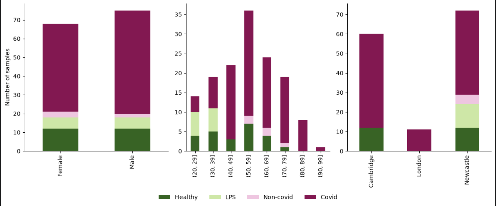
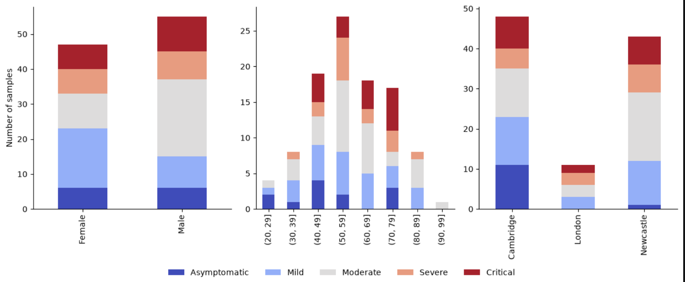
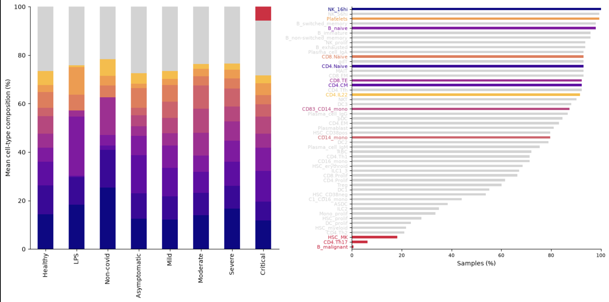
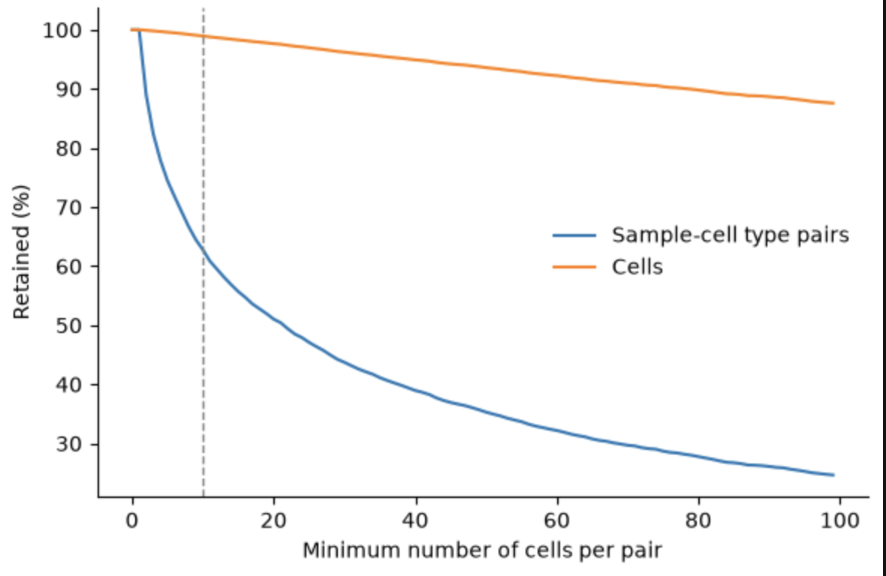
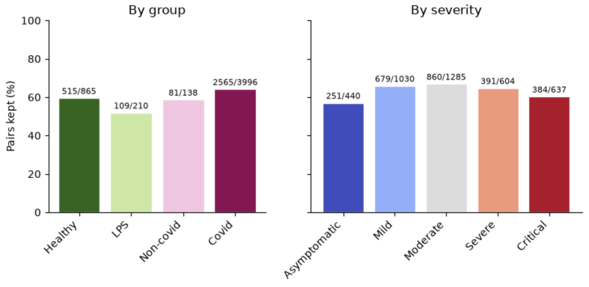

# Introduction
COVID-19 severity is usually described as a progressive disease: patients move from asymptomatic to mild, moderate, severe and critical state. These categories are assigned by doctors and determine the treatment. However, it is not clear if the molecular signals measured in a patient’s blood correlate with the disease degree of severity. 

Hence, we propose to test whether clinically determined severity is reflected in single-cell RNA-sequencing data. Instead of treating individual cells as the unit of analysis, we look at donors: by pseudobulking each donor’s cells within a given cell type, we build one expression profile per donor and cell type and ask what these profiles say about the patient.

This website will first walk you through how donor profiles are constructed and whether clinical severity emerges from them. Subsequently, we examine whether severity is better described as a continuous gradient or as a series of discrete stages. Finally, we show where clinical labels and RNA-sequencing data agree, where they diverge and why these findings matter in defining the COVID-19 phase.
 

# Research Questions

    <a href="aim1.md" style="color: black; ; background-color:  #c1ddf8; padding: 10px; text-align: center; border-radius: 15px;">
        <strong style="font-size: 24px;"> Aim 1 </strong> . 
        Does clinically defined severity emerge from donor profiles? Where do profiles support or contradict the assigned clinical severity, and which cell types are most informative for separating particular severity groups?
    </a>
      <a href="aim2.md" style="color: black;  background-color:  #c1ddf8; padding: 10px; text-align: center; border-radius: 15px;">
        <strong style="font-size: 24px;"> Aim 2 </strong> . 
        Is severity better modelled as a continuous gradient or as discrete stages? Where are neighbouring severities clearly separated, and where do they overlap, and which cell types change smoothly versus sharply between particular severity groups?
    </a>

# Exploring the data and preprocessing

Before diving into our aims, we need first to establish how versatile our data collection is. For this reason we explore the data and perform some preprocessing and filtering in order to keep only those we are interested in.

## Exploration
We assess the data in order to determine if the gender, age interval or the collection site influence  the Covid-19 status and severity. Our result could be summarized as follows: 

*Figure 1: Sample distribution in relation to gender, age interval and site of collection*

In the first histogram we can see that the gender is relatively balanced in the data set including the distribution of the groups studied (e.g. Healthy, LPS, etc.). 

The second histogram shows the sample distribution across ages. We can clearly see that the healthy donors were in the younger age groups with LPS group present only in the first two age groups (20 to 39). From age 80, only Covid cases are present.

The third histogram displays the unequal distribution in the number of samples between the regions. In London, there is roughly 6 time less samples than in Camberage and 7 times less samples than in Newcastel. We can immediately see that the majority of samples come from the Covid-19 patient in all the 3 sites. However, Newcastel is the only one where the two control samples were collected (Non-covid and LPS).

*Figure 2: Severity stages representation across the gender, age interval and site of collection*

The gender histogram shows that the major differences are in the distribution of Mild and Moderate cases. Namely, in female group there are two times more Mild cases, while the male group contains three times more of Moderate cases.

The age histogram shows an unequal distribution of cases according to the disease severity. In younger age (20 to 39) and old groups (80-99) there are no Critical cases.

The collection sites contribute differently in terms of disease severity. As observed previously, London site took into account only the Covid-19 manifested patients, hence the total lack of the Asymptomatic group. The Cambridge site has the equally represented all disease stages. 

*Figure 3: Cell-type composition across groups and disease severities.*

The 10 most abundant cell types account for approximately 75% of the mean cell-type composition across all groups and disease severities.

Differences in cell-type composition can be observed between groups. The LPS group shows a higher proportion of naive B cells, while CD16+ NK cells are more abundant in both the LPS and non-COVID-19 groups.

A particularly interesting pattern emerges among the less frequently detected cell types. Cell types present in 20% or fewer of the samples are exclusively observed in donors with critical COVID-19. Although detected in relatively few samples, these populations collectively account for more than 5% of the mean cell-type composition in this group.

These rare populations include B-cell malignancies, T helper 17 (Th17) cells and cells associated with the megakaryocyte lineage.

## Prepossessing

To ensure data quality and reliable cell-type representation across samples, some filtering steps were applied. 
We start the preprocessing mechanism by filtering the cells that have not enough expressed genes (defined number: less than 200 genes expressed). In this way, only samples of good quality and enough information are kept for reliable downstream analyses. Then, cells with too many expressed genes (defined number: more than 5000 genes) were removed because high reads number can be due to misidentifying two cells as one or abnormal profiles. Finally, we remove the cells with more than 10% of mitochondrial counts, which is the standard parameter for damaged cells. 

The filtering results in only 0.2% cell loss: initial number of cells is 647366 and after filtering goes down to 646101. This suggests that the dataset already had good cell-level quality as determined by our QC (quality control) criteria.

*Figure 4:  Effect of different minimum cell thresholds on data retention.*

The second filtering was applied to ensure that enough cells of the same identity are present in each sample. Here we introduce the term “sample-cell type pairs” which defines the number of cells per cell type in the given sample. In order to determine the appropriate minimum threshold to use, we analysed how different thresholds affect the percentage of sample-cell type pairs remain after applying the filtering with this specific threshold.

As shown in Figure 4, the fraction of remaining sample-cell type pairs decreases fast for thresholds below 10 cells, after which the slope is less steep. On the other hand, the total number of retained cells remains much higher regardless of the threshold chosen (orange line). According to this graph the minimum threshold of 10 cells per pairs was selected. At this threshold 62.8% of the sample-cell pairs and 98.9% of individual cells remain. This filter ensures the good cell type representation per each sample. 

*Figure 5: Distibution of the remaining data across the groups and severity*

In this graph we address the question if the last filter did not result is imbalanced information loss. Here are displayed the remaining data distributed into study groups as well as the disease severity. 

In the group case, the LPS group is the one that lost the most data points (around 48%).  The three other groups have all kept around 60% of they data samples. 
For the severity histogram, the two stages that are the most affected are: Asymptomatic with 57.05% and Critical with 60.28% data conserved.
After these filtering steps, the genes detected in fewer than three cells across the remaining dataset were excluded. This results in removing 688 genes (2.78%), so 24049 remain.

The remaining cells were then grouped by sample, donor and cell type. Raw gene counts were summed within each sample–cell type pair to generate sample-level expression profiles. These aggregated counts were subsequently normalised to 10,000 counts per profile and log1p-transformed to obtain comparable expression profiles across samples.
